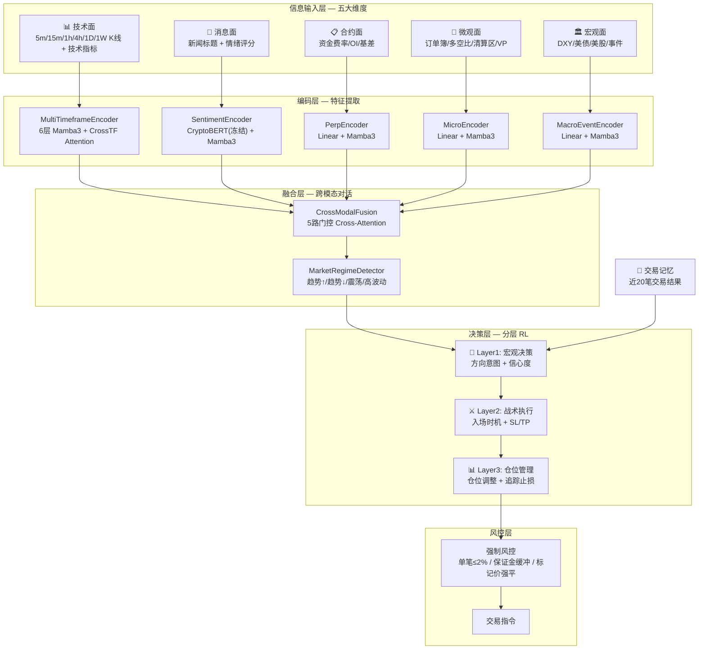
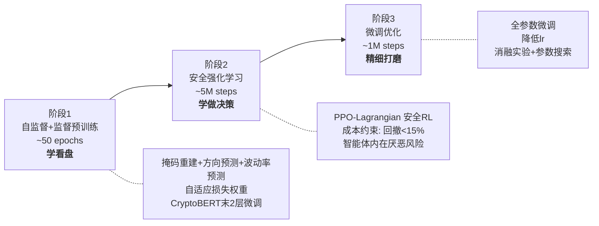

# Mamba3 多模态永续合约交易智能体 — 完整训练方案

---

## 一、项目概述

### 1.1 目标

构建一个基于 **Mamba3 SSM** 架构的多模态深度强化学习交易智能体，使其**像专业永续合约交易员一样**进行交易决策。模型同时感知技术面、消息面、链上数据、微观结构和宏观经济等五大维度的信息，通过分层决策（宏观判断→战术执行→仓位管理）做出完整的交易指令。

### 1.2 为什么选择 Mamba3

| 特性 | Transformer | Mamba3 SSM |
|---|---|---|
| 序列长度扩展 | O(L²) 二次方 | O(L) 线性 |
| 推理速度 | 每步需注意力所有token | 恒定时间递推 |
| 长程记忆 | 依赖位置编码+注意力 | SSM 状态天然累积 |
| 适合交易场景 | ⚠️ 上下文窗口有限 | ✅ 无限历史状态累积 |

Mamba3 核心创新：广义梯形离散化、复值 RoPE（数据依赖旋转位置编码）、MIMO 公式、QK-归一化。这些让 SSM 在保持线性复杂度的同时，匹敌 Transformer 的表达能力。

### 1.3 项目目录结构

```
f:/mamba3_Yui/
├── configs/
│   └── default.yaml              # 全局配置
├── data/
│   ├── raw/                      # 原始数据
│   └── processed/                # 处理后数据
├── src/
│   ├── model/
│   │   ├── components.py         # 基础模块 (RMSNorm/SwiGLU/RoPE/SSD)
│   │   ├── mamba3_core.py        # Mamba3 SSM 核心
│   │   ├── encoder.py            # 多时间框架编码器 + 市场状态检测
│   │   ├── news_encoder.py       # CryptoBERT 新闻情绪编码器
│   │   ├── context_encoder.py    # 合约/微观/宏观/事件 4子编码器
│   │   ├── fusion.py             # 5路门控跨模态融合
│   │   └── agent.py              # 分层决策 (宏观/战术/仓位) Actor-Critic
│   ├── env/
│   │   └── trading_env.py        # Gymnasium 交易环境
│   ├── data/
│   │   ├── fetcher.py            # 全维度数据采集
│   │   ├── features.py           # 全维度特征工程
│   │   ├── microstructure.py     # 订单簿/清算区/Volume Profile
│   │   └── dataset.py            # 多模态对齐 DataLoader
│   ├── training/
│   │   ├── pretrain.py           # 阶段1: 自监督+监督预训练
│   │   ├── ppo.py                # 阶段2: PPO-Lagrangian 安全RL
│   │   └── trainer.py            # 统一训练管理
│   └── backtest/
│       ├── engine.py             # 回测引擎
│       └── metrics.py            # 评估指标
├── scripts/
│   ├── fetch_data.py             # 数据下载
│   ├── train.py                  # 训练入口
│   └── backtest.py               # 回测入口
├── tests/                        # 单元测试
├── requirements.txt
└── README.md
```

---

## 二、完整模型架构

### 2.1 总体架构图



### 2.2 模块详细设计

#### 2.2.1 Mamba3 SSM 核心 (`mamba3_core.py`)

基于 `mamba3-minimal` 参考实现，移植核心 SSM 块：

```
Mamba3Config:
  d_model: 256       # 模型维度
  n_layer: 可变       # 每个编码器独立配置
  d_state: 64        # SSM 状态维度 (必须偶数, 用于 RoPE 配对)
  expand: 2           # 扩展因子, d_inner = expand × d_model = 512
  headdim: 32         # 头维度, nheads = d_inner / headdim = 16
  chunk_size: 64      # SSD 分块大小
  use_mimo: false     # MIMO 模式 (可选, 增加表达力但更耗显存)

Mamba3 Block 前向传播:
  Input u: (batch, seq_len, d_model)
  │
  ├─ in_proj → z (门控), x (SSM输入), B, C, Δ, λ, θ
  ├─ Δ → softplus(Δ + dt_bias) → 步长
  ├─ λ → sigmoid(λ) → 梯形插值参数  
  ├─ B, C → QK-RMSNorm → + Learnable Bias → RoPE(累积角度)
  ├─ 梯形系数: α=exp(ΔA), β=(1-λ)Δα, γ=λΔ
  ├─ 两次 SSD 分解:
  │   ├─ y_γ = SSD(x×γ, dA, B, C)     ← 当前时刻项
  │   └─ y_β = SSD(x_prev×β, dA, B_prev, C)  ← 前一时刻项
  ├─ y = y_γ + y_β + D×x               ← 跳跃连接
  ├─ y = y × SiLU(z)                    ← 门控
  └─ out_proj → output: (batch, seq_len, d_model)

每层结构 (Llama 风格):
  x → RMSNorm → Mamba3 → +x (残差) → RMSNorm → SwiGLU MLP → +x (残差)
```

#### 2.2.2 多时间框架编码器 (`encoder.py`)

```
输入: 6个时间框架的 K 线特征
  5m  features: (batch, 2048, n_feat) → LinearProj → Mamba3×6层 → h_5m
  15m features: (batch, 1024, n_feat) → LinearProj → Mamba3×6层 → h_15m
  1h  features: (batch, 1024, n_feat) → LinearProj → Mamba3×12层 → h_1h  ← 主时间框架
  4h  features: (batch, 512, n_feat)  → LinearProj → Mamba3×6层 → h_4h
  1D  features: (batch, 256, n_feat)  → LinearProj → Mamba3×4层 → h_1d
  1W  features: (batch, 128, n_feat)  → LinearProj → Mamba3×3层 → h_1w

跨时间框架融合:
  Query = h_1h (以交易级别为主视角)
  Key/Value = concat(h_5m[-1], h_15m[-1], h_4h[-1], h_1d[-1], h_1w[-1])
  → CrossAttention → h_tech: (batch, seq_len, d_model)

MarketRegimeDetector:
  h_tech → Linear → 4分类 (TREND_UP / TREND_DOWN / RANGE / HIGH_VOL)
```


**技术面特征（每个时间框架独立计算）**：

```
⭐ 特征精简: 移除 Mamba3 可自动学习的冗余指标
  传统技术指标 (RSI/MACD/Stoch/BB) 本质上都是 OHLCV 的确定性数学变换,
  Mamba3 的 SSM 状态天然累积历史, 加上掩码自监督预训练,
  模型能端到端地从原始数据中学到这些模式。
  保留冗余指标反而会: (1)增加特征维度拖慢训练 (2)让掩码重建失去意义

原始 K 线 (端到端学习, 5维):
  open/close_norm          # 相对前收盘价归一化
  high/low_norm            # 相对前收盘价归一化
  log_return               # 对数收益率

K 线形态 (模型辅助, 4维):
  body_ratio               # 实体占比 = |open-close| / (high-low)
  upper_shadow_ratio       # 上影线占比
  lower_shadow_ratio       # 下影线占比
  high_low_range           # 振幅 = (high-low) / close

不可替代指标 (模型难以自学, 3维):
  ATR(14)                  # 平均真实波幅 — 止损/仓位归一化基准
  VWAP_deviation           # 偏离成交量加权均价 — 机构级参考
  volume_change            # 成交量相对20MA的比率

时间编码 (周期性节律, 4维):
  hour_sin, hour_cos       # 24h 内的时间位置
  weekday_sin, weekday_cos # 一周内的位置

总计: ~16维/每时间框架 (原方案22维, 精简27%)
```

#### 2.2.3 新闻情绪编码器 (`news_encoder.py`)

```
数据源: CryptoNews API (免费, 含情绪评分, 历史追溯到2020)

⚠️ 风险修复 #1: FinBERT → CryptoBERT
  FinBERT 基于华尔街传统金融文本训练, 对 Crypto 黑话
  (HODL, Rekt, Rug pull, FUD, To the moon) 理解不足, 会产生情绪误判。
  替换为 ElKulako/cryptobert (HuggingFace, 专门针对 Crypto 推文训练)
  预训练阶段: 解冻最后2层微调; RL阶段: 完全冻结

处理流程:
  新闻标题 → CryptoBERT tokenizer → token_ids
  token_ids → CryptoBERT (末2层可微调) → news_embedding (768维)
  
  每根K线窗口内 0~10 条新闻:
    → Attention-Weighted Pooling (时效性加权: 越近权重越高)
    → 无新闻时: 可学习的 no_news 占位 embedding
  
  聚合序列 → Linear(768 → d_model) → Mamba3(n_layer=3)
  → h_news: (batch, seq_len, d_model)
```

#### 2.2.4 上下文编码器组 (`context_encoder.py`)

4 个专业子编码器，各自处理一个维度：

**PerpEncoder（永续合约专属）**：
```
输入特征 (9维):
  funding_rate, funding_rate_zscore, funding_rate_percentile, funding_rate_streak,
  oi_change_pct, oi_price_divergence (4种组合编码),
  mark_index_basis, basis_volatility, basis_zscore

→ Linear(9 → d_model) → Mamba3(n_layer=2) → h_perp
```

**MicroEncoder（微观结构）**：
```
输入特征 (13维):
  bid_depth_10, ask_depth_10, bid_ask_imbalance, spread_bps,
  bid_slope, ask_slope,
  top_trader_ls_ratio, global_ls_ratio, ls_divergence,
  liq_cluster_above_pct, liq_cluster_below_pct, liq_magnet_direction,
  poc_distance_pct, vah_distance_pct, val_distance_pct, in_value_area

→ Linear(13 → d_model) → Mamba3(n_layer=2) → h_micro
```

**MacroEncoder（宏观联动）**：
```
输入特征 (8维):
  dxy_return_1d, dxy_trend_5d,
  us10y_level, us10y_change_1d,
  ndx_return_1d, spx_return_1d,
  btc_ndx_corr_30d, btc_dxy_corr_30d

→ Linear(8 → d_model) → Mamba3(n_layer=2) → h_macro
```

**EventEncoder（事件驱动）**：
```
输入特征 (7维):
  fed_rate_event, fed_rate_direction, cpi_surprise,
  token_unlock_pct, days_to_halving,
  usdt_mcap_change_1d, net_exchange_flow_direction

→ Linear(7 → d_model) → Mamba3(n_layer=2) → h_event
```

#### 2.2.5 跨模态门控融合 (`fusion.py`)

```
主模态: h_tech (技术面, 作为 Query)
辅模态: h_news, h_perp, h_micro, h_macro, h_event (作为 K/V)

对每个辅模态:
  h_cross_i = MultiHeadCrossAttention(Q=h_tech, K=h_i, V=h_i)
  gate_i = sigmoid(Linear(concat(h_tech, h_cross_i)))   ← 自动学习权重
  h_tech = h_tech + gate_i × h_cross_i                  ← 残差门控融合

效果:
  平常: gate_news ≈ 0.1, gate_macro ≈ 0.1      → 技术面主导
  重大新闻: gate_news ≈ 0.8                      → 消息面权重自动拉高
  FOMC日: gate_macro ≈ 0.7                       → 宏观权重拉高
  清算密集区附近: gate_micro ≈ 0.6               → 微观结构权重拉高

最终: h_fused → 市场状态检测 → 分层决策
```

#### 2.2.6 分层决策智能体 (`agent.py`)

```
⭐ 多频率分层激活机制 (Multi-Frequency Activation):
  环境基础 Tick 为 5m (每根 5m K线收盘推进一步), 但各层激活频率不同, 模拟真人看盘习惯:
  - Layer1: 每根 1h K线收盘时激活 (大级别看方向)
  - Layer2: 每根 5m K线收盘时激活 (小级别找精确入场)
  - Layer3: 有持仓时每根 5m K线收盘激活 (实时跟踪止损)

Layer 1 — 宏观决策者 (MacroAgent, 1h 激活一次):
  输入: h_fused + regime_probs + trade_memory + account_state
  输出:
    direction_intent: Categorical(4) → 做多 / 做空 / 保持 / 全平
    confidence: Beta分布 → 0.0~1.0
  训练: PPO (独立策略头+价值头)

Layer 2 — 战术执行者 (TacticalAgent, 5m 激活一次):
  触发: Layer1 confidence > 0.6
  输入: h_fused + direction_intent + h_5m (精确入场信号)
  输出:
    execute: Categorical(3) → 立即执行 / 等待 / 放弃
    stop_loss_atr: Box(0.5, 3.0) → 初始止损 = x * ATR(1h)
    risk_reward: Box(1.5, 4.0) → 初始止盈 = ratio * 止损距离
  训练: PPO

Layer 3 — 仓位管理者 (PositionManager, 5m 激活一次):
  触发: 有持仓时持续运行
  输入: 持仓状态 + 浮盈浮亏 + 市场状态变化
  输出:
    position_adjust: Categorical(4) → 保持 / 加仓+25% / 减仓-25% / 全平
    trailing_stop: Box(0, 1) → 追踪止损强度 (向当前价格收紧的比例)
  训练: PPO

⭐ 止盈止损机制 (硬性反射弧, 实时触发):
  Layer2/3 负责"设定"和"移动"止损价(SL)/止盈价(TP)。
  环境(Env)负责在 5m K线内部检查 high/low 是否触碰 SL/TP。一旦触碰, 
  立即强制平仓。这不需要模型推理参与, 就像真人的条件单(反射弧)。

交易记忆 (TradeMemory):
交易记忆 (TradeMemory) 与跨虚空记忆网络:
  不仅保存交易结果，更引入**时间衰减**与**跨品种宏观池**，防止刻舟求剑。
  
  1. 本品种自省记忆 (Self-Reflection Memory, 容量 20 笔):
     [方向, 持仓时长, 盈亏比, 入场市场状态, 出场原因, 距离当前的时间戳 Δt]
     → 加入时间衰减因子 (Time-Decay): exp(-λ * Δt)
     → 效果: 3个月前连亏 5 次的记忆，权重远小于昨天连亏 2 次的记忆。
     
  2. 跨品种情绪记忆池 (Cross-Asset Macro Pool):
     维护一个全局状态: [BTC近期胜率, ETH近期胜率, SOL近期胜率]
     → 效果: 如果发现最近在 ETH 和 SOL 上频繁止损（山寨币流动性枯竭），
             MacroAgent 会自动降低整个加密货币敞口的置信度，收缩 BTC 仓位。

  → 将 (衰减本品记忆 + 跨品种池) → Linear → 128维向量 → 输入 Layer1

⭐ 动态选币与多目标监控池 (AssetSelector):
  模型不需要绑定死某一个币种，而是具备类似“雷达扫描”的自主选币能力。
  - 监控广度: 每台 i5 推理机可以同时并发监控 50~100 个高流动性交易对。
  - 动态剔除池: 每隔 1 小时，系统通过轻量级的预检测 (如价格异动率、合约持仓量突变) 
    从 Binance 几百个币种中筛选出 Top 20 活跃币种扔给模型监控。
  - 自主开单逻辑 (Winner Takes All): 
    如果同时在 5 个币种上出现了开仓信号，模型会比较它们的 `confidence` (信心度) 
    和 `regime_probs` (市场状态明确度)，仅挑选得分最高的 1~2 个币种执行开仓，
    避免同一套资金在高度同质化的山寨币上重复暴露风险。
```

---

## 三、数据管道

### 3.1 数据源汇总

| 维度 | 数据项 | 来源 | 频率 | API |
|---|---|---|---|---|
| **技术面** | K线 OHLCV (6个时间框架) | Binance Futures | 5m/15m/1h/4h/1D/1W | `/fapi/v1/klines` |
| | 多品种 (ETH/SOL) | Binance Futures | 1h | 同上 |
| **合约面** | 资金费率 | Binance Futures | 8h | `/fapi/v1/fundingRate` |
| | 未平仓合约量 | Binance Futures | 5m | `/futures/data/openInterestHist` |
| | 标记价格 | Binance Futures | 逐K线 | `/fapi/v1/premiumIndex` |
| **微观面** | 订单簿深度 | Binance Futures | 快照 | `/fapi/v1/depth` |
| | 大户多空比 | Binance Futures | 5m | `/futures/data/topLongShortAccountRatio` |
| | 全市场多空比 | Binance Futures | 5m | `/futures/data/globalLongShortAccountRatio` |
| | 清算统计 | Binance Futures | 实时 | WebSocket `forceOrder` |
| **消息面** | 新闻标题+情绪 | CryptoNews API | 实时 | `cryptonews-api.com` |
| | 恐惧贪婪指数 | alternative.me | 每日 | `api.alternative.me` |
| **链上** | 交易所净流入 | CryptoQuant Free | 每小时 | `cryptoquant.com` |
| | USDT市值 | CoinGecko | 每日 | `api.coingecko.com` |
| **宏观** | DXY/美债/美股 | Yahoo Finance | 日线 | `yfinance` |
| | 经济事件日历 | investing.com | 事件 | 抓取 |

### 3.2 特征工程

**总特征维度**：

| 模块 | 特征数 | 说明 |
|---|---|---|
| 技术面 (每个TF) | ~16 | 原始OHLCV 5 + 形态4 + ATR/VWAP/量3 + 时间4 |
| 永续合约 | 9 | 资金费率4 + OI2 + 基差3 |
| 微观结构 | 13 | 订单簿6 + 多空比3 + 清算区3 + VP1 |
| 宏观联动 | 8 | DXY2 + 美债2 + 美股2 + 相关系数2 |
| 事件 | 7 | 美联储3 + 代币1 + 减半1 + USDT1 + 链上1 |
| 新闻情绪 | 768→d_model | CryptoBERT embedding |
| 账户状态 | 7 | 持仓方向/比例/浮盈/保证金等 |
| 交易记忆 | 128 | 近20笔交易编码 |

### 3.3 数据预处理

```
1. 标准化: RobustScaler (四分位数, 抗异常值)
   - 对所有连续特征, 用训练集 fit, 验证/测试集 transform

2. 序列长度对齐 (满血版设定 - 极大感受野):
   5m:  2048 步 = ~7.1天 (全周微观细节)
   15m: 1024 步 = ~10.6天
   1h:  1024 步 = ~42.6天 (一个多月的宏观连续体)
   4h:  512 步 = ~85.3天
   1D:  256 步 = ~256天
   1W:  128 步 = ~2.4年
   确保: 每根主级K线能在更低级别找到对应的子K线序列

3. 时间序列分割 (严格按时间, 无数据泄露):
   训练集: 2020-01-01 ~ 2023-06-30 (70%)
   验证集: 2023-07-01 ~ 2024-03-31 (15%)
   测试集: 2024-04-01 ~ 至今       (15%)

4. 新闻数据对齐:
   每根 1h K线 → 收集该小时内所有新闻标题
   → CryptoBERT tokenize → 存储 token_ids + 时间戳
   → 超过 10 条时, 保留情绪最极端的 10 条

⚠️ 风险修复 #3: 强制数据延迟 (Anti Look-ahead Bias)
5. 非实时数据强制 Lag:
   多频率数据混合极易引入未来函数, 回测虚高实盘秒亏。
   
   强制延迟规则 (在 dataset.py 中硬编码):
   | 数据类别         | 延迟规则                               |
   |-----------------|---------------------------------------|
   | 实时K线 5m/15m/1h | 当根K线收盘后才可用 (延迟=0)             |
   | 4h K线          | 收盘后对齐到下一根5m                     |
   | 日线/周线        | 次日/次周 00:00 UTC 才可用 (延迟>=1根K线) |
   | 资金费率        | 结算后下一根K线才可用                     |
   | 订单簿快照      | 上一根K线的快照 (延迟1步)                |
   | 多空比/OI       | 上一数据点 (延迟1个周期)                  |
   | 恐惧贪婪指数    | 延迟1天                                |
   | DXY/美债/美股   | 延迟1天 (日线收盘后次日才可用)            |
   | 链上数据        | 延迟2小时 (确认+API发布延迟)             |
   | USDT市值        | 延迟1天                                |
   | 新闻            | 发布时间 < 当前K线开盘时间才可用          |
   
   验证: test_no_lookahead.py 逐特征检查时间戳合法性
```

---

## 四、训练流程

### 4.1 三阶段训练概览



### 4.2 阶段 1: 自监督 + 监督预训练 — 学看盘

**目的**：让模型学会从多模态数据中提取有用特征。

#### 4.2.1 自监督任务: 掩码时间序列重建 (Masked TS Modeling)

```
⭐ 深度优化 #1: 金融市场信噪比极低, 直接预测未来收益标签充满噪音。
  加入自监督学习: 随机遮挡历史序列片段, 让模型重建缺失内容,
  逼迫模型真正理解市场微观结构的动态演变。

掩码策略:
  对每个时间框架的输入序列:
  - 随机选择 15% 的时间步
  - 被选中的时间步: 80% 替换为 [MASK] token, 10% 替换为随机时间步, 10% 保持原样
  - 掩码块长度: 1~5 根连续 K 线 (模拟连续缺失)
  
重建目标:
  被遮挡的 K 线特征 (OHLCV + 技术指标) → MSE 重建损失
  仅计算被遮挡位置的损失

效果: 模型学会 "双底形态后面通常跟上涨" "量价背离后通常转向" 等模式,
      而不是去拟合充满噪音的未来标签
```

#### 4.2.2 监督任务: 多目标预测

```
辅助预测头 (预训练后移除):
  h_fused → Linear → 方向分类 (3类: 涨/跌/盘整)
  h_fused → Linear → 收益率预测 (回归: 未来12根K线收益率)
  h_fused → Linear → 波动率预测 (回归: 未来12根K线波动率)
  h_fused → Linear → 市场状态分类 (4类: 趋势上/下/震荡/高波动)

标签构造:
  方向: 未来12根K线收盘价 vs 当前, 涨>0.5%=涨, 跌>0.5%=跌, 否则盘整
  收益率: 未来12根K线的累积对数收益率
  波动率: 未来12根K线的收益率标准差
  市场状态: 基于滚动ADX+波动率历史分位数的规则标注
```

#### 4.2.3 自适应损失权重 (Uncertainty Weighting)

```
⭐ 深度优化 #3: 固定 w1*L1+w2*L2+... 容易导致某个任务
  (如波动率预测) 主导梯度, 其它任务学不好。
  
  引入 Homoscedastic Uncertainty Weighting (Kendall et al. 2018):
  每个任务 i 有一个可学习参数 log_sigma_i, 损失变为:
    L_total = sum_i [ (1 / (2*sigma_i^2)) * L_i + log(sigma_i) ]
    
  效果: 
  - sigma_i 大 → 该任务权重自动降低 ("这个任务噪声大, 别太信")
  - sigma_i 小 → 该任务权重自动提高 ("这个任务信号清晰, 多学")
  - log(sigma_i) 正则项防止所有权重趋于0

最终损失:
  L = L_mask_reconstruction          ← 自监督
    + uncertainty_weighted(L_direction, L_return, L_volatility, L_regime)
```

#### 4.2.4 训练配置

```
训练模块:
  ✅ 多时间框架编码器 (encoder.py)
  ✅ 新闻情绪编码器 (news_encoder.py, CryptoBERT 末2层解冻)
  ✅ 上下文编码器组 (context_encoder.py)
  ✅ 跨模态融合 (fusion.py)
  ✅ 掩码重建头 + 辅助预测头 (预训练后移除)

优化器: AdamW (lr=3e-4, weight_decay=0.01)
调度器: Cosine Annealing (warmup 5 epochs → cosine decay)
批次: 64
训练: 50 epochs, 早停 patience=10
混合精度: torch.amp.autocast('cuda')
梯度裁剪: max_norm=1.0
```

### 4.3 阶段 2: 强化学习训练 — 学做决策

**目的**：在模拟交易环境中学习"赚钱的决策策略"。类比："实习交易员转为模拟盘实操，通过几万次交易积累经验"。

#### 4.3.1 交易环境 (`trading_env.py`)

```
Episode 设计 (基础 Tick = 5m K线):
  每个 Episode 从历史数据中随机截取 8640 根 5m K线 (~30天)
  环境每 step 向前推进 5 分钟
  
  结束条件:
    - 数据耗尽
    - 账户资金 ≤ 0 (强平)
    - 达到最大 8640 步

环境内置机制:
  ✅ 手续费: maker 0.02%, taker 0.04%
  ✅ 滑点: 0.01% + f(ATR, 成交量) 动态估计
  ✅ 资金费率: 每8h按真实历史数据结算
  ✅ 标记价格强平: 维持保证金率 < 阈值时触发
  ✅ 止损/止盈自动触发: 在每个 5m step 内部, 检查 5m 实测 high/low 是否击穿 SL/TP; 击穿则触发条件单平仓 (不经过模型)
  ✅ 追踪止损: PositionManager 调控, 止损价逐步沿价格移动
  ✅ 分批建仓/平仓: 每次调整 25% 仓位
  ✅ 单笔最大亏损: ≤ 总资金 2%
  ✅ 保证金缓冲: ≥ 30%

⚠️ 风险修复 #4: 环境性能向量化
  RL需500万步交互, 8并行环境。纯Python循环+pandas会导致训练数周。
  解决方案:
  - 所有状态用预分配 NumPy 数组, 零动态分配
  - 观察数据预加载到连续内存 (np.float32)
  - 订单撮合/盈亏/保证金全部 NumPy 向量运算, 无 for 循环
  - 8并行使用 gymnasium.vector.SyncVectorEnv
  - 关键热路径 step/reset 用 @numba.njit 加速
  - 目标: 单环境 >5000 steps/sec, 8并行 >30000 steps/sec
```

#### 4.3.2 奖励函数

```
⚠️ 风险修复 #2: 分阶段渐进式奖励 (Anti Reward Hacking)
  复杂奖励函数会导致智能体"卡BUG": 比如永久空仓可避开所有惩罚,
  同时收获耐心奖励。解决方案: 奖励随训练阶段渐进式复杂化。
  所有阶段都包含 inaction_penalty: 连续100步无交易 → -0.01/步 (防空仓陷阱)
```

**Phase A (0~1M steps) — 极简奖励，只学"会交易"**：
```python
reward_a = realized_pnl - trade_cost - funding_payment - inaction_penalty
```

**Phase B (1M~3M steps) — 加入风险感知**：
```python
reward_b = reward_a + unrealized_pnl_delta*0.01 - drawdown*0.3 + cut_loss*0.1 + rr_bonus*0.2
```

**Phase C (3M~5M steps) — 完整纪律性奖励**：
```python
reward_c = reward_b + entry_quality*0.1 + exit_quality*0.1 + trailing_stop*0.05
         - overtrading*0.1 - revenge_trade*0.2 + patience*0.05 + confluence*0.15
         + regime_alignment*0.1
)
```

#### 4.3.3 PPO-Lagrangian 安全强化学习

```
⭐ 深度优化 #2: PPO → PPO-Lagrangian (Safe RL)
  原方案的风控是硬编码在环境中 (亏2%强平), 智能体本身没有"风险"概念。
  PPO-Lagrangian 在训练目标中引入成本约束, 让智能体内在厌恶风险。

算法: PPO-Lagrangian (Constrained MDP)
  max_policy  E[reward]                    ← 最大化收益
  subject to  E[cost] <= cost_limit        ← 约束回撤

成本函数 (Cost Function):
  c_t = max(0, current_drawdown - 0.10)    ← 回撤超过10%开始产生成本
  cost_limit = 0.05                        ← 累积成本预算
  
  效果: 智能体必须在 "最大回撤 < 15%" 的约束下追求最大收益
  Lagrangian乘子 lambda 自动调节:
    - 回撤偏高时 lambda 上升 → 更保守
    - 回撤安全时 lambda 下降 → 更激进

分层训练策略:
  第一阶段 (0~1M steps): 
    训练 Layer1 (宏观决策), 冻结 Layer2/3 (用规则替代)
    冻结编码器 (使用预训练权重)
    cost_limit 宽松 = 0.10
    
  第二阶段 (1M~3M steps):
    解冻 Layer2, 联合训练 Layer1+2
    编码器低 lr 微调 (lr * 0.1)
    cost_limit 收紧 = 0.07
    
  第三阶段 (3M~5M steps):
    解冻 Layer3, 联合训练全部
    全参数微调 (降低 lr)
    cost_limit 最终值 = 0.05
```

```
PPO-Lagrangian 超参数:
  rollout_steps: 2048
  ppo_epochs: 10
  batch_size: 256
  lr_policy: 1e-4
  lr_lagrangian: 5e-3       # Lagrangian 乘子学习率 (较快收敛)
  gamma: 0.99
  gae_lambda: 0.95
  clip_range: 0.2
  entropy_coeff: 0.01
  value_coeff: 0.5
  cost_value_coeff: 0.5     # 成本价值函数权重
  max_grad_norm: 0.5
  lagrangian_init: 0.01     # 初始乘子
  lagrangian_max: 10.0      # 乘子上限

并行环境: n_envs = 8

课程学习:
  Phase A (0~1M): 只用趋势明显的历史片段 (ADX>25)
  Phase B (1M~3M): 混合趋势+震荡
  Phase C (3M~5M): 全数据 (含极端: LUNA/FTX)
```

### 4.4 阶段 3: 微调与消融

```
目的: 精细打磨, 找到最优配置

消融实验矩阵 (逐项移除, 对比回测指标):
  ┌──────────────────┬──────────┬──────────────┐
  │ 实验             │ 移除模块  │ 对比指标      │
  ├──────────────────┼──────────┼──────────────┤
  │ Full Model       │ -        │ baseline     │
  │ - 新闻情绪       │ 新闻编码  │ Sharpe/MDD   │
  │ - 微观结构       │ 微观编码  │ Sharpe/MDD   │
  │ - 宏观联动       │ 宏观编码  │ Sharpe/MDD   │
  │ - 合约特征       │ 合约编码  │ Sharpe/MDD   │
  │ - 多时间框架     │ 仅1h     │ Sharpe/MDD   │
  │ - 分层决策       │ 单层Agent │ Sharpe/MDD   │
  │ - 交易记忆       │ 无记忆    │ Sharpe/MDD   │
  └──────────────────┴──────────┴──────────────┘

超参数搜索 (Optuna):
  搜索空间: lr, gamma, gae_lambda, entropy_coeff, 各模块n_layer
  目标: 测试集夏普比率
```

---

## 五、回测与评估

### 5.1 回测引擎 (`engine.py`)

```
流程:
  加载训练好的 Agent
  → 在测试集上逐 K 线决策 (完全模拟实盘)
  → 记录全部: 交易日志, 持仓变化, 资金曲线, 门控权重

模拟细节:
  ✅ 手续费 + 滑点 (同训练环境)
  ✅ 资金费率结算
  ✅ 标记价格强平检查
  ✅ 止损/止盈/追踪止损自动触发
```

### 5.2 评估指标 (`metrics.py`)

| 指标 | 公式/说明 | 合格标准 |
|---|---|---|
| 年化收益率 | 月收益率复利 | > 0% |
| 夏普比率 | (R - Rf) / σ | > 1.0 |
| 索提诺比率 | (R - Rf) / σ_down | > 1.5 |
| 最大回撤 | max(peak - trough) / peak | < 30% |
| Calmar 比率 | 年化收益 / 最大回撤 | > 1.0 |
| 胜率 | 盈利笔数 / 总笔数 | > 40% |
| 盈亏比 | 平均盈利 / 平均亏损 | > 1.5 |
| 平均持仓时长 | 非0即合理 | 4~72 K线 |
| 月均交易次数 | 非过度交易 | 10~100 |

### 5.3 可视化分析

```
输出内容:
  1. 资金曲线 (含回撤阴影)
  2. 月度/年度收益热力图
  3. 交易分布: 盈利 vs 亏损的持仓时长/仓位大小
  4. 门控权重时序: 各模态在不同时期的权重变化
  5. 市场状态 vs 策略行为: 每种状态下的交易统计
  6. 极端事件复盘: LUNA/FTX/ETF 等事件期间的决策回放
```

---

## 六、配置文件完整版

```yaml
# configs/default.yaml
# ⭐ 满血解锁版 (要求 >48GB VRAM 算力集群) ⭐

# ═══ 模型架构 ═══
model:
  d_model: 512       # 满级宽度
  d_state: 128       # 更大 SSM 状态容量
  headdim: 64        
  chunk_size: 128
  use_mimo: true     # 开启 MIMO 增强表达力
  
  timeframes:
    5m:  { n_layer: 6, seq_len: 2048 }
    15m: { n_layer: 6, seq_len: 1024 }
    1h:  { n_layer: 12, seq_len: 1024 }  # 核心层深度翻倍
    4h:  { n_layer: 6, seq_len: 512 }
    1D:  { n_layer: 4, seq_len: 256 }
    1W:  { n_layer: 3, seq_len: 128 }
  
  news_encoder:
    n_layer: 4
    base_model: "ElKulako/cryptobert"
    freeze_strategy: "partial"
    unfreeze_last_n_layers: 4    # 放开更多层微调
    max_headlines_per_bar: 30    # 接收更多噪音内的高价值新闻
  
  context_encoders:
    perp:   { n_layer: 4, n_features: 9 }
    micro:  { n_layer: 4, n_features: 13 }
    macro:  { n_layer: 4, n_features: 8 }
    event:  { n_layer: 4, n_features: 7 }
  
  fusion:
    type: "gated_cross_attention"
    n_heads: 16      # 更多注意力头
  
  agent:
    trade_memory_size: 20
    confidence_threshold: 0.6

# ═══ 数据与监控池 ═══
data:
  symbols: ["BTCUSDT", "ETHUSDT", "SOLUSDT", "DOGEUSDT"] # 回测时的强相关品种
  primary_symbol: "BTCUSDT"
  live_monitoring_pool_size: 50    # 实盘时同时监控的最大交易对数量
  live_selection_top_k: 2          # 同时最多持仓的独立币种数
  start_date: "2020-01-01"
  macro_tickers: ["DX-Y.NYB", "^TNX", "^NDX", "^GSPC"]
  news_api: "cryptonews"
  train_ratio: 0.70
  val_ratio: 0.15
  test_ratio: 0.15

# ═══ 交易环境 ═══
env:
  initial_balance: 10000
  leverage: 5
  maker_fee: 0.0002
  taker_fee: 0.0004
  max_position_ratio: 0.5
  single_trade_max_loss: 0.02
  margin_buffer_ratio: 0.3
  use_mark_price_liquidation: true
  episode_length: 8640    # 5m steps, = 30 days
  base_tick: "5m"

# ═══ 阶段1: 自监督+监督预训练 ═══
pretrain:
  epochs: 100        # 满血算力支持更长周期
  batch_size: 128    # 超大批次稳定梯度
  lr: 3.0e-4
  weight_decay: 0.01
  warmup_epochs: 10
  pred_horizon: 24   # 预测更远的未来

  early_stop_patience: 10
  mask_ratio: 0.15
  mask_block_size: [1, 5]
  loss_weighting: "uncertainty"   # auto-adaptive, not fixed

# ═══ 阶段2: PPO-Lagrangian 安全RL ═══
rl:
  algorithm: "ppo_lagrangian"
  total_timesteps: 15_000_000   # 延长 3 倍交互时间
  n_envs: 32                    # 并行宇宙火力全开，避免局部最优
  rollout_steps: 8192           # 收集海量经验再更新
  ppo_epochs: 10
  batch_size: 1024              # 适应海量 rollout 的大批次
  lr_policy: 1.0e-4
  lr_lagrangian: 5.0e-3
  gamma: 0.99
  gae_lambda: 0.95
  clip_range: 0.2
  entropy_coeff: 0.01
  value_coeff: 0.5
  cost_value_coeff: 0.5
  max_grad_norm: 0.5
  lagrangian_init: 0.01
  lagrangian_max: 10.0
  cost_limit_schedule: [0.10, 0.07, 0.05]
  curriculum:
    phase_a_steps: 1_000_000
    phase_b_steps: 2_000_000
    phase_c_steps: 2_000_000
  layer_schedule:
    layer1_only_steps: 1_000_000
    layer12_steps: 2_000_000
    full_steps: 2_000_000

# ═══ 阶段3: 微调 ═══
finetune:
  steps: 1_000_000
  lr: 1.0e-5
  ablation_experiments: true
```

---

## 七、依赖项

```
# requirements.txt
torch>=2.1.0
einops>=0.7.0
gymnasium>=0.29.0
numpy>=1.24.0
pandas>=2.0.0
pyarrow>=12.0.0
pyyaml>=6.0
requests>=2.31.0
yfinance>=0.2.28
transformers>=4.35.0    # CryptoBERT
numba>=0.58.0           # 环境向量化加速
tensorboard>=2.14.0
scikit-learn>=1.3.0
matplotlib>=3.7.0
pytest>=7.4.0
tqdm>=4.65.0
optuna>=3.3.0           # 超参数搜索
```

---

## 八、验证方案

```bash
# 1. 单元测试
python -m pytest tests/ -v

# 2. 数据下载
python scripts/fetch_data.py

# 3. 训练
python scripts/train.py --config configs/default.yaml

# 4. 回测
python scripts/backtest.py --checkpoint best_model.pt

# 5. 消融实验
python scripts/train.py --ablation remove_news
python scripts/train.py --ablation remove_micro
# ...
```

验证标准：
- 预训练: 方向预测准确率 > 40% (随机基准 33%)
- RL 训练: 奖励曲线持续上升并趋稳
- 回测: 夏普比率 > 0, Agent 行为合理
- 共振测试: 多维度信号共振时入场，Agent 信心和仓位显著提高
- 极端事件: LUNA/FTX 期间能识别并规避风险
- 未来函数: test_no_lookahead.py 全特征时间戳合法性通过
- 奖励黑客: 交易频率 > 10次/月 (排除永久空仓)
- 安全RL: 测试集最大回撤 < 15% (PPO-Lagrangian 约束生效)

---

## 九、已知风险与对策

| # | 风险 | 对策 | 状态 |
|---|---|---|---|
| 1 | FinBERT 对 Crypto 黑话水土不服 | 替换为 CryptoBERT，预训练解冻末2层微调 | ✅ |
| 2 | 奖励函数过复杂导致 Reward Hacking | 分3阶段渐进引入 + inaction_penalty 防空仓 | ✅ |
| 3 | 多频率数据混合引入未来函数 | 强制 Lag 延迟表 + 单元测试逐特征验证 | ✅ |
| 4 | Gymnasium 环境 Python 循环性能瓶颈 | NumPy 预分配 + @numba.njit + SyncVectorEnv | ✅ |
| 5 | 金融市场信噪比低，监督标签噪音大 | 加入掩码时间序列自监督学习 | ✅ |
| 6 | 智能体无内在风险概念 | PPO-Lagrangian 安全RL + 成本约束 | ✅ |
| 7 | 多任务梯度失衡 | Uncertainty Weighting 自适应损失权重 | ✅ |

---

## 十、实盘部署与交易系统架构 (Deployment & Live Trading System)

既然模型已经在 48GB 算力上被训练为“满血版”，在实际将其接入真金白银的加密货币永续合约市场时，需要一个极其稳健的外围**交易系统（Trading System）**来承载这个 AI 大脑。

### 10.1 实盘系统总体架构

实盘系统采用 **“大脑与躯干分离”** 的微服务架构设计，确保 AI 推理的延迟不会影响到底层订单的执行速度。

```mermaid
graph TD
    subgraph "云端/本地推理机 (AI 大脑) - 纯 CPU 或轻量 GPU"
        M[Mamba3 满血版模型 .pth]
        I[推理引擎 Inference Engine]
        I -->|加载| M
        I -->|生成交易意图 (方向/仓位/止损止盈)| MQ[Redis 消息队列 / ZeroMQ]
    end

    subgraph "高性能交易网关 (躯干) - 贴近交易所机房 (同城部署)"
        TG[交易网关 Trading Gateway]
        MQ -->|监听意图| TG
        TG -->|订单执行挂单/撤单| B[Binance Futures API]
        TG -->|风控拦截| RM[独立安全断路器]
    end

    subgraph "数据管道 (感官) - 异步非阻塞"
        WS[WebSocket 数据泵] -->|实时拉取 5m/1h K线 & 深度| DB[(内存数据库 Redis)]
        API[REST API 抓取] -->|定时拉取新闻/链上数据| DB
        DB -->|按照 5m 节律组装特征张量| I
    end

    subgraph "交易所端 (最终防线)"
        B -->|触发| EX_SL[交易所原生止损单 Stop-Market]
    end
    
    RM -.->|越权订单| TG
```

### 10.2 核心模块说明

#### 10.2.1 定时特征组装器 (Feature Builder)
*   **职责**：实盘数据没有预处理好的 CSV。系统必须在 `xx:04:59` 到 `xx:05:00` 的一秒钟内，从数据库中拼装出符合预训练格式的 2048 步历史张量，以及 CryptoBERT 的新闻向量。
*   **技术栈**：`asyncio` + `Redis` + `NumPy`。
*   **容错**：如果某条非核心新闻 API 挂了，系统必须用零向量 Padding 过去，绝不能阻塞主技术面的推理。

#### 10.2.2 交易网关与订单流 (Trading Gateway)
*   **职责**：将模型输出的“宏观意图”转化为交易所 API 指令。
*   **拆单逻辑**：如果模型要求下 20 万 U 的仓位，网关需要使用 TWAP (时间加权) 或冰山委托将大单拆分，避免一次性吃透几十档订单簿造成自身滑点。
*   **双重防线止损 (Critical)**：
    *   **第一道防线**：程序内部侦测价格，触价发单（类似回测环境）。
    *   **第二道防线（保命）**：在发送开仓市价单的同时，**必须**挂一张交易所原生的 **条件止损单 (Stop-Market)**。这是防止您所在的云服务器突然断网、断电导致爆仓的终极保障。

#### 10.2.3 独立安全断路器 (Safety Circuit Breaker)
独立于 AI 之外的写死规则系统，即便是模型发疯，也过不了这一关：
*   **单日亏损锁死**：如果发现今日账户权益回撤超过 5%，直接拔掉 AI 的网线并平掉所有仓位（通过 API Key 权限控制）。
*   **高频发单限制**：防止代码死循环导致 1 分钟内发单 100 次被交易所封禁 API。

### 10.3 部署硬件推荐矩阵

不同于训练时需要的 48GB / 双卡 4090 算力怪兽，实盘推理（因为只做前向传播，且最多积累 2048 步历史状态）的消耗极低。

| 模块 | 推荐硬件部署 | 理由 |成本预估|
|---|---|---|---|
| **交易网关 + 数据泵** | 阿里云/AWS (香港或东京节点) <br> 2核 4G 内存 | 必须极其贴近币安服务器，追求毫秒级网络延迟。无需高算力。 | ~100元/月 |
| **Mamba3 推理机** | 本地闲置电脑 (如 i5-13400 + 16G)<br>或最低配云端显卡服务器 (如 RTX 3060 8G) | 纯 CPU 推理也只需 0.5 秒。如果需要 CryptoBERT 秒级分析，配一张便宜的二手显卡（或单纯用量化版 CPU BERT）足以应对每 5 分钟一次的唤醒。 | ~自有/200元月 |
| **存储层** | 与交易网关同机的 Redis | 热数据缓存。 | 极低 |

### 10.4 实盘演练 SOP (Standard Operating Procedure)

在代码写完并用 48GB 算力训练出一个漂亮的模型后，上实盘的规范步骤如下：

1.  **沙盒干跑 (Paper Trading)**：将模型连入 Binance Testnet 环境。系统 7x24 小时运行，不投入真钱，观察网络稳定性、特征组装是否带缺失值、订单拆分是否正确、滑点跟回测环境是否一致。
2.  **微型实盘 (Micro Live)**：投入 100 U 真金白银。验证真实市场的 maker/taker 费率扣除逻辑，以及在极端插针行情下，原生止损单是否能 100% 被执行。
3.  **资金放量 (Scaling up)**：模型确认盈利曲线与回测高度拟合后，逐步放大投入资金。
